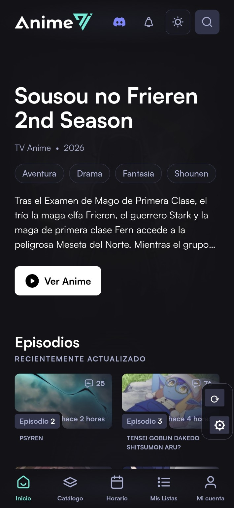
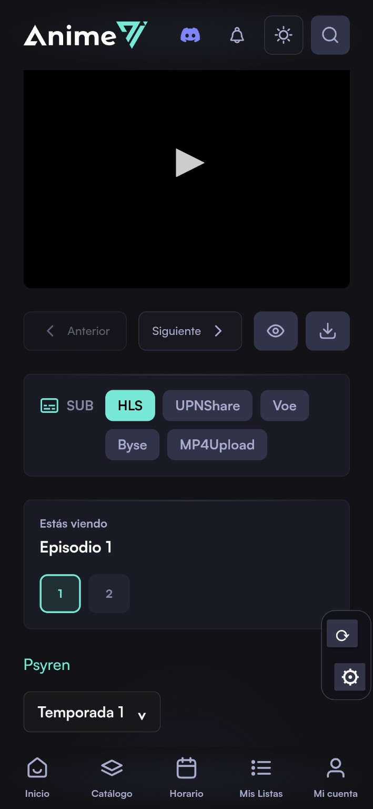
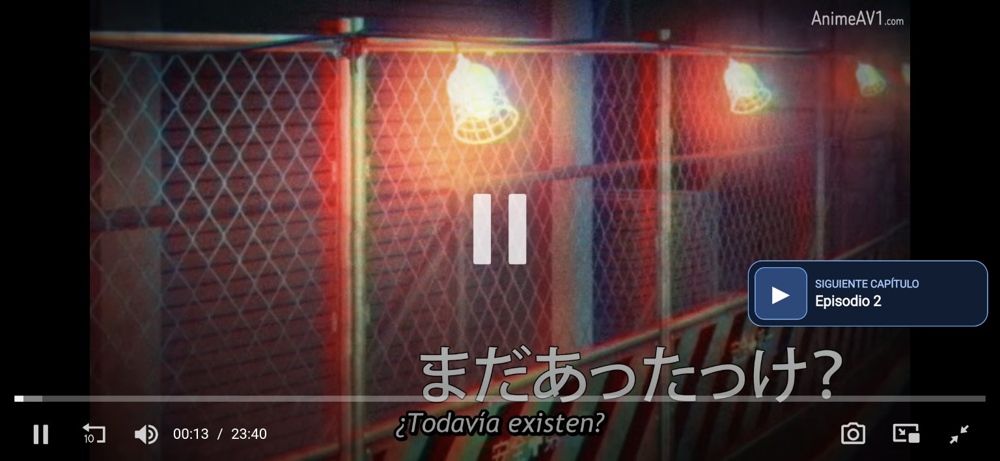
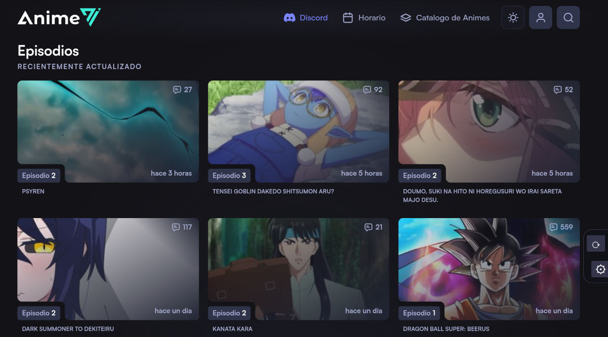
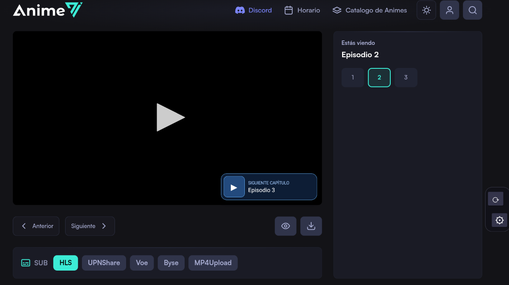
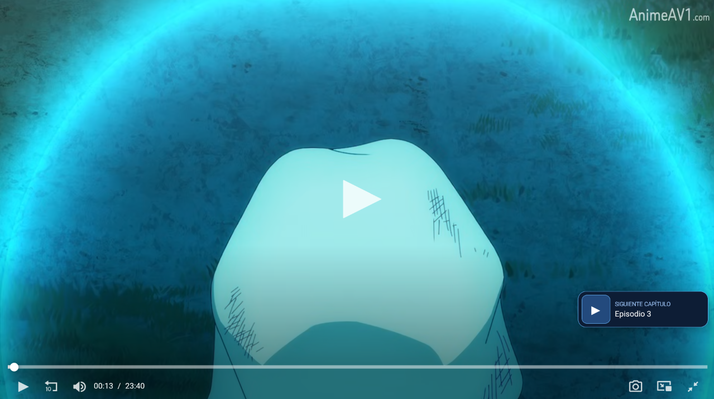

# AnimeAV1 para Android

Esta aplicación es independiente para facilitar el acceso y la navegación por [AnimeAV1](https://animeav1.com/), especialmente en Android TV, TV Stick, teléfonos y otros dispositivos Android compatibles.

## ¿Qué es AnimeAV1 para Android?

AnimeAV1 es una aplicación que carga el sitio web original mediante una vista integrada y ofrece una navegación adaptada al uso de controles remotos y pantallas táctiles.

Su objetivo es facilitar el uso del sitio web en dispositivos donde la navegación convencional puede resultar incómoda.

## Contenido y funcionamiento

La aplicación muestra el contenido disponible en el sitio web y no aloja ni almacena por cuenta propia los videos.

El catálogo, la información de las series, los enlaces, los reproductores y las fuentes de reproducción proceden del sitio web o de servicios externos. Su disponibilidad y funcionamiento dependen de dichos servicios.

## Privacidad

La aplicación necesita acceso a Internet para cargar el sitio web y utilizar sus funciones.

El sitio web y los servicios externos pueden utilizar cookies, publicidad y herramientas de análisis. Para conocer sus prácticas de privacidad, consulta la [Política de privacidad de AnimeAV1](https://animeav1.com/pages/politica-de-privacidad).

## Derechos y titularidad

AnimeAV1 para Android es un desarrollo independiente. La publicación de esta aplicación no implica por sí misma una relación oficial, asociación ni autorización por parte de los responsables del sitio web.

Los nombres, marcas, logotipos, imágenes, videos y demás contenidos pertenecen a sus respectivos titulares.

## Actualizaciones

Las versiones de la aplicación se publican en la sección [Releases de GitHub](https://github.com/sonyc22/animeav1-updates/releases).

La información de la versión estable disponible para el actualizador integrado se encuentra en el archivo `update.json` de este repositorio.

## Aviso

Esta aplicación tiene como finalidad facilitar la navegación por el sitio web desde dispositivos Android. El acceso a contenidos y servicios de terceros está sujeto a su disponibilidad y a las condiciones aplicables.

## Capturas de pantalla

### Teléfonos Android

**Pantalla principal**

**Reproductor y selección de episodios**

**Siguiente capítulo**

### Android TV, TV Stick y tablets

**Catálogo**

**Siguiente capítulo dentro del reproductor**

**Reproducción a pantalla completa**

